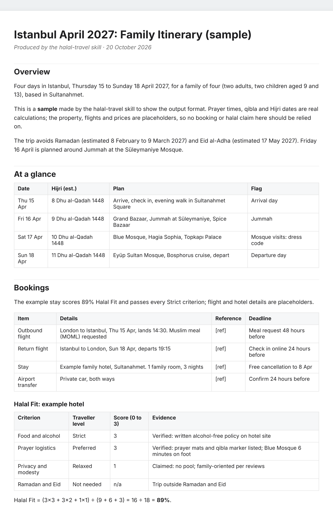
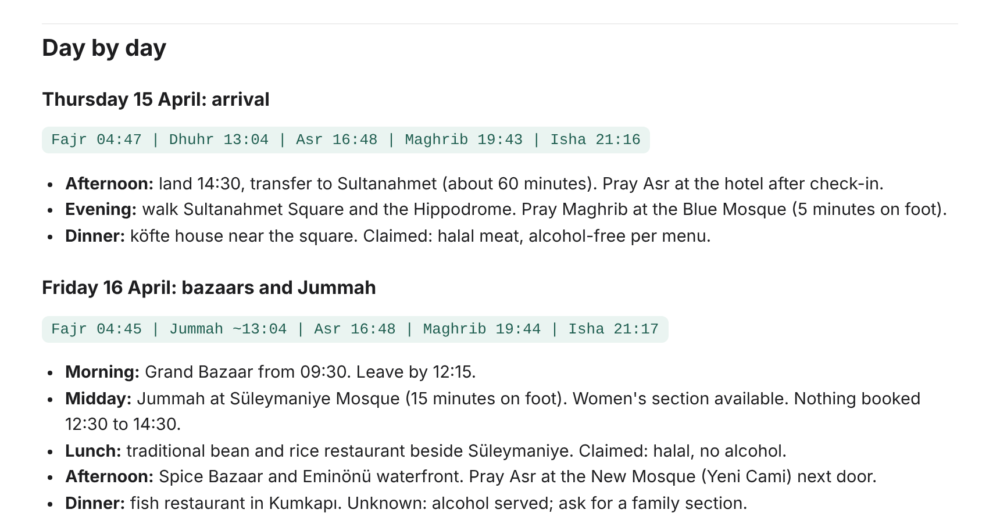
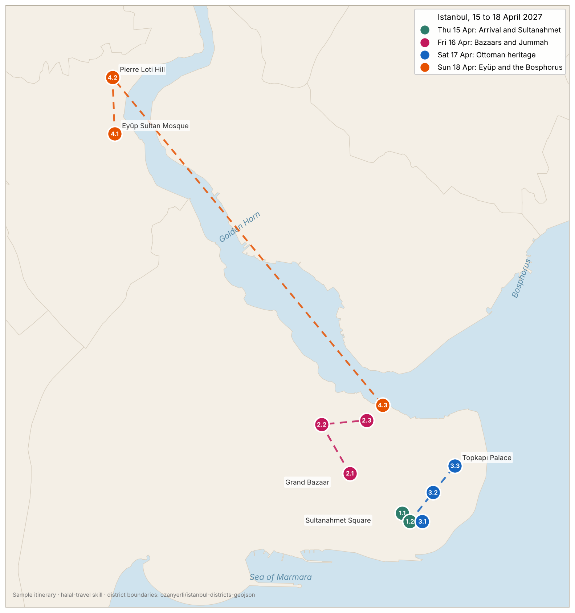
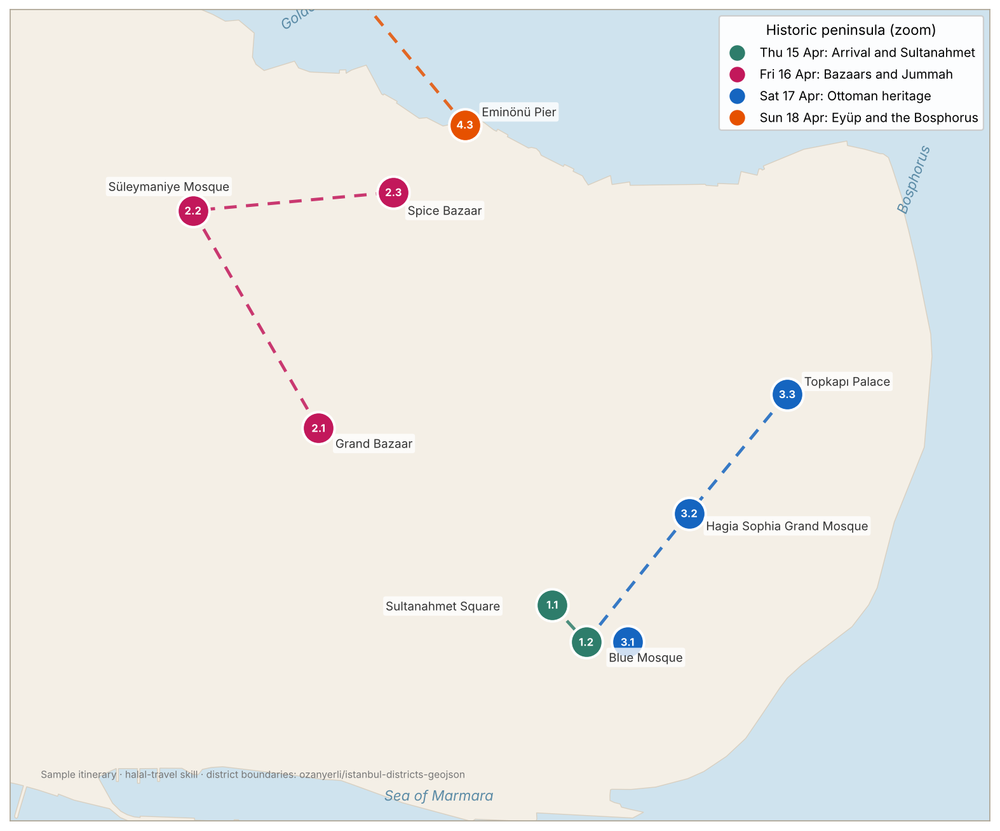
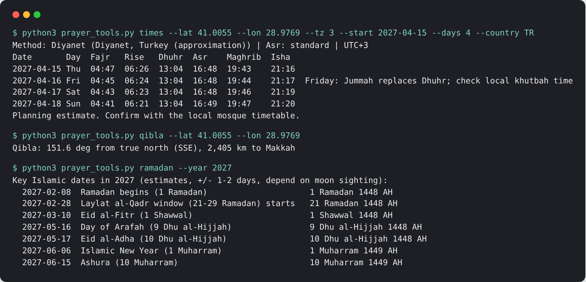

# Halal Travel Planner: a Claude skill for halal holidays

[](LICENSE)  

An open-source Claude skill for planning halal holidays and Muslim-friendly travel, from first idea to day-by-day itinerary. It covers halal food, alcohol-free hotels, prayer times, qibla direction, Jummah, women-only and private pools, Ramadan and Eid.

**Project page:** [farazfookeer.github.io/halal-travel](https://farazfookeer.github.io/halal-travel/)

It checks every hotel, restaurant, flight and activity against the traveller's own standards across four criteria: food and alcohol, prayer logistics, privacy and modesty, and Ramadan and Eid. Each option gets a Halal Fit Score with evidence labels (Verified, Claimed, Unknown), so nothing is called halal without a source.

## What it does

1. **Intake**: who is travelling, dates, budget, and how strict each criterion should be
2. **Calendar check**: flags Ramadan, Eid, Arafah and Hajj season overlaps
3. **Destination shortlist**: live checks on the Global Muslim Travel Index, travel advice and entry rules
4. **Research and scoring**: properties scored for halal fit, with nearby mosques and halal food
5. **Shortlist with booking links**: the traveller books and pays
6. **Optional browser booking**: only with explicit consent, always stopping before payment
7. **Itinerary**: shareable doc, day-by-day map and Word or PDF, built around prayer times and Jummah

## Example: Istanbul, April 2027

A sample four-day family trip produced with the skill. Prayer times, qibla and Hijri dates are real calculations; the hotel, flights and halal claims are placeholders.

### Itinerary doc



Each day opens with its prayer times, and every food suggestion carries an evidence label.



Full text: [examples/istanbul-2027/itinerary.md](examples/istanbul-2027/itinerary.md)

### Map





- **Interactive on GitHub:** open [itinerary-map.geojson](examples/istanbul-2027/itinerary-map.geojson) and GitHub renders it as a zoomable map with a popup for each stop.
- **Interactive in a browser:** download [itinerary-map.html](examples/istanbul-2027/itinerary-map.html) and open it. Each day can be toggled on and off.

### Prayer tools



## Offline prayer tools

`skills/halal-travel/scripts/prayer_tools.py` needs no network or packages:

```bash
python3 prayer_tools.py times --lat 41.0082 --lon 28.9784 --tz 3 --start 2027-04-10 --days 7 --country TR
python3 prayer_tools.py qibla --lat 51.5072 --lon -0.1276
python3 prayer_tools.py ramadan --year 2027
python3 prayer_tools.py methods
```

Prayer times follow the standard astronomical method with 19 regional calculation conventions, Standard or Hanafi Asr, and high-latitude adjustments. Hijri dates use the arithmetic calendar and can differ from moon-sighting announcements by 1 to 2 days. All outputs are planning estimates; confirm with the local mosque.

Run the tests with `python3 -m unittest discover skills/halal-travel/scripts`.

## Install

- **Claude Code**: add this repo as a plugin, or copy `skills/halal-travel` into `~/.claude/skills/`.
- **Claude app**: upload the `skills/halal-travel` folder as a custom skill, or save it from a skill proposal card.

## Principles

- The traveller sets the standard; the skill never assumes the strictest or loosest reading.
- No fatwas: where schools differ, positions are presented neutrally.
- Current facts (prices, visas, rankings, Eid dates) are looked up and date-stamped.
- The traveller always makes the payment.

Built by Silsila Labs.

## Licence

MIT
